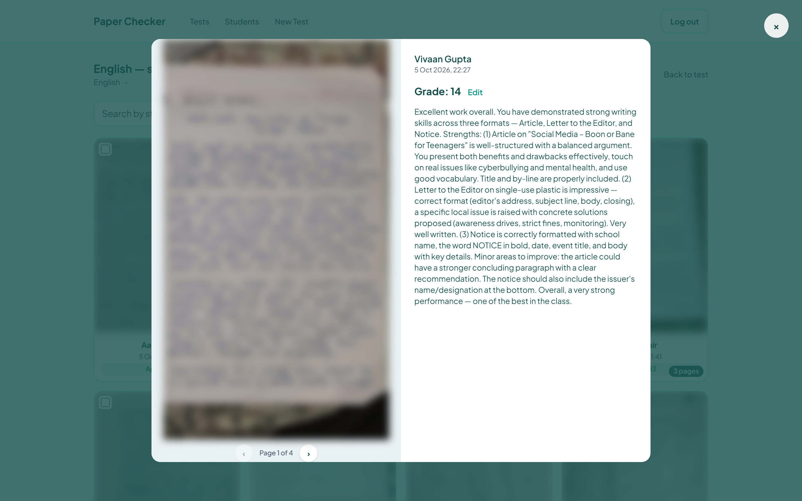
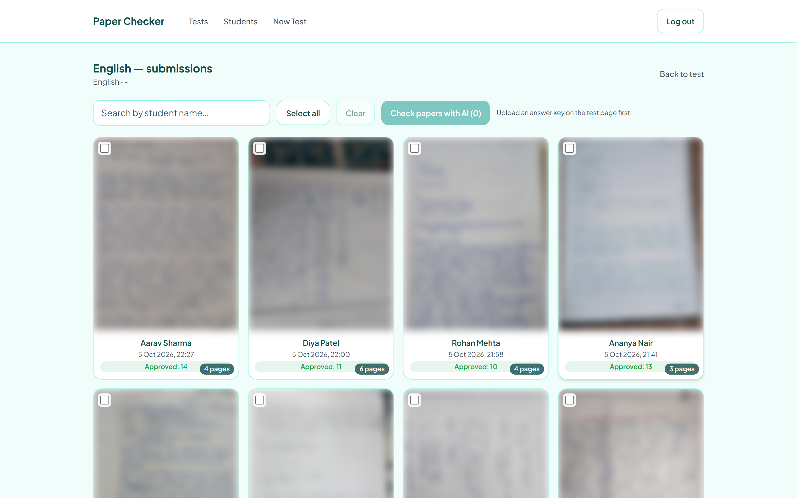
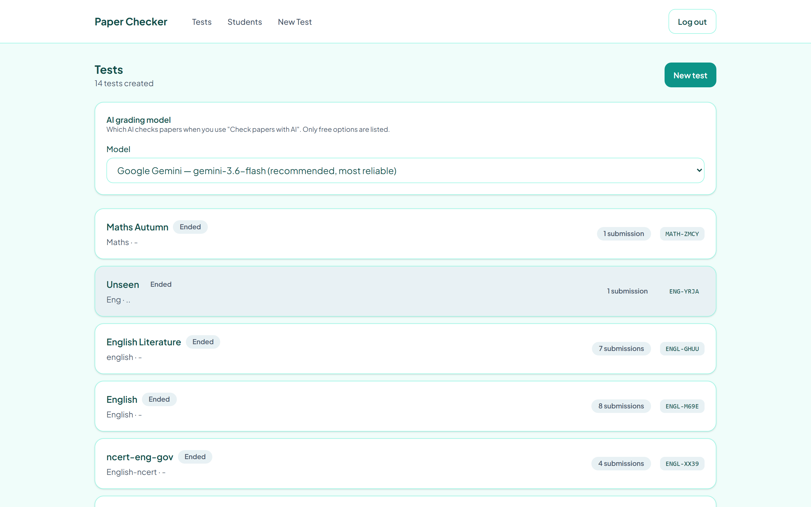
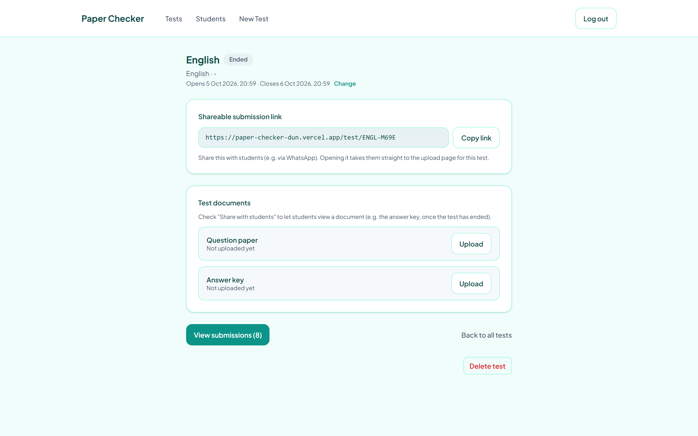
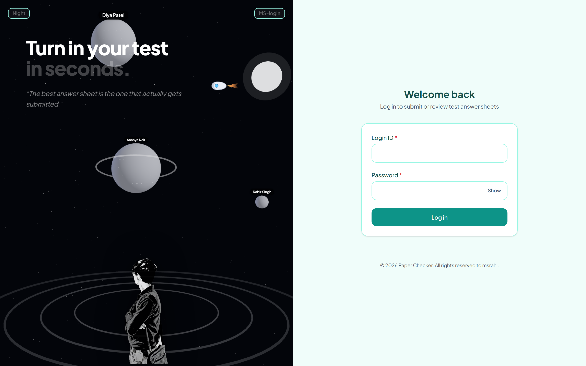

# Paper Checker

**An AI-assisted test grading portal for schools.** Students photograph their handwritten
answer sheets from a phone; teachers get them graded against an answer key by a
vision-capable LLM, review the result, and release scores — all from one web app.

<p>
  
  
  
  
  
  
  
</p>

**Live demo:** <https://paper-checker-dun.vercel.app>

---

## Screenshots

> Student names and handwriting in these screenshots are anonymised — the app is in
> real use by a school class.

| AI review — the core of the app |
| --- |
|  |
| *The model's grade and per-question feedback, shown beside the answer sheet. The teacher can override the score before approving, and nothing reaches the student until they do.* |

| Submission gallery | Test management |
| --- | --- |
|  |  |
| *Every submission for a test, with grade status at a glance. Select any subset and grade them in one batch.* | *All tests with submission counts and share codes, plus the instance-wide AI model selector.* |

| Test detail | Student login |
| --- | --- |
|  |  |
| *One shareable link per test, an editable time window, and question-paper / answer-key uploads with independent share toggles.* | *The landing page, with a Three.js scene rendered via react-three-fiber.* |

---

## The problem

A teacher running chapter-wise tests for ~80 students manually collects paper sheets,
carries them home, grades each one by hand, and transcribes marks into a spreadsheet.
That loop costs hours per test and gives students feedback days late.

Paper Checker compresses that loop: the test is a shareable link, the submission is a
phone photo, the first-pass grade is produced by an LLM reading the handwriting against
the official marking scheme, and the teacher's job becomes **review and approve** rather
than grade-from-scratch.

## Features

### For students
- Log in with a teacher-issued login ID and password — no self-registration, no email.
- Open a shared test link; the page enforces the test's start/end window.
- Capture or upload **up to 20 photos** per submission (a single answer sheet spanning
  multiple pages is treated as one continuous document).
- Images are **compressed client-side** before upload, so submissions work on slow
  mobile connections.
- View the question paper and answer key once the teacher chooses to share them, and see
  their score and per-question feedback once it is approved.

### For teachers (admin)
- **Roster management** — add students by name and section, issue credentials, reset a
  forgotten password, delete a student (cascading their submissions and photos).
- **Test creation** — each test is one chapter and gets its own shareable link and
  editable start/end time (handled in IST, not UTC).
- **Document attachments** — upload a question paper and answer key per test, each with
  an independent "share with students" toggle.
- **Submission gallery** — every submission for a test in one grid, with a lightbox for
  reading handwriting page by page.
- **AI grading** — one click per submission sends the answer sheet, answer key, and
  optional question paper to the configured model and stores a structured result:
  total score, per-question marks awarded vs. possible, per-question feedback, and an
  overall note written to the student.
- **Review and release** — the AI score is a *draft*. The teacher can override the score
  and feedback, then approve; nothing reaches the student until it is approved.

## How the AI grading works

```
Submission photos ─┐
Answer key ────────┼──► prompt + inline file parts ──► vision LLM ──► strict JSON
Question paper ────┘                                                      │
                                                                          ▼
                                            { totalScore, totalMaxScore,
                                              questions[ { question,
                                                           marksAwarded,
                                                           marksPossible,
                                                           feedback } ],
                                              overallFeedback }
                                                          │
                                 persisted as a draft ────┴──► teacher review ──► approved
```

Design decisions worth calling out:

- **Provider-agnostic interface.** `lib/ai/` exposes a single `gradeWithProvider()`
  entry point over a `GradeParams → GradeResult` contract, with Google Gemini and
  OpenRouter behind it. Adding a provider means adding one adapter file, not touching
  call sites.
- **Curated model list, not a free-text field.** The admin UI offers only models that
  were actually verified to read an image *and* return schema-valid JSON. This avoids the
  common failure mode where an operator picks a model that silently can't do vision.
- **Automatic key fallback.** A secondary Gemini API key is used automatically when the
  primary one hits its daily rate limit, so a grading session doesn't dead-end mid-way.
- **Failures are recorded, not swallowed.** A failed grade sets `gradeStatus = "error"`
  with a truncated message on the submission, so the teacher sees *why* and can retry.
- **Defensive PDF handling.** Many question-bank PDFs ship with owner-password-only
  encryption (print/copy restrictions). Those open fine in any viewer but Gemini's
  document ingestion rejects them with a bare `400`. `lib/pdf.ts` losslessly strips that
  restriction layer with `pdf-lib`, and genuinely password-protected PDFs are detected
  and rejected **at upload time** rather than failing later during grading.

## Architecture

```
┌─────────────────────────────────────────────────────────────┐
│  Next.js 16 App Router  (React 19 Server + Client Components)│
│                                                              │
│  app/login            app/test/[code]      app/admin/*       │
│  app/dashboard        (student submit)     (roster, tests,   │
│                                             submissions)     │
├─────────────────────────────────────────────────────────────┤
│  Route handlers — app/api/*                                  │
│  auth · students · tests · submissions · documents · settings│
│  all wrapped in withErrorHandling() + requireRole() guards   │
├──────────────┬──────────────────┬───────────────────────────┤
│  Prisma 6    │  Vercel Blob     │  lib/ai (Gemini /          │
│  → Postgres  │  (private store) │   OpenRouter adapters)     │
└──────────────┴──────────────────┴───────────────────────────┘
```

- **Auth** is custom and cookie-based: `bcryptjs` for password hashing, `jose` for a
  signed `HS256` JWT in an `httpOnly`, `sameSite=lax`, `secure`-in-production cookie with
  a 30-day lifetime. Admins are provisioned from an `ADMIN_USERS` env var; students live
  in the database. A single `requireRole()` helper gates every protected route.
- **Uploads** go straight from the browser to a **private** Vercel Blob store via a
  short-lived signed upload URL, so answer sheets never transit the app server. Reads
  are proxied through authorized route handlers (`/api/blob-image`,
  `/api/submissions/[id]/image`), so no blob URL is ever publicly guessable.
- **Validation** is schema-first with `zod` at every API boundary.
- **Grading runs server-side** with `maxDuration = 60` on the route, keeping API keys off
  the client entirely.

## Data model

| Model | Purpose |
| --- | --- |
| `Student` | Roster entry + credentials. Submissions cascade on delete. |
| `Test` | One chapter. Unique `code` backs the shareable link; holds the time window and the question-paper / answer-key blob paths with per-document share flags. |
| `Submission` | One per `(student, test)` pair, enforced by a unique constraint. Holds the photo blob paths plus the full grading lifecycle: `gradeStatus`, AI score/feedback, teacher's `finalScore`/`finalFeedback`, and `gradedAt` / `approvedAt` timestamps. |
| `Settings` | Singleton row for instance-wide config — active AI provider and model, plus landing-page copy. |

## Tech stack

| Layer | Choice |
| --- | --- |
| Framework | Next.js 16 (App Router), React 19, TypeScript 5 |
| Styling | Tailwind CSS 4 |
| Database | PostgreSQL (Neon, via Vercel Storage) with Prisma 6 |
| File storage | Vercel Blob (private access) |
| Auth | `bcryptjs` + `jose` JWT in an httpOnly cookie |
| Validation | `zod` |
| AI | Google Gemini · OpenRouter (pluggable adapters) |
| PDF | `pdf-lib` |
| 3D landing visual | `three` + `@react-three/fiber` + `@react-three/drei` |
| Hosting | Vercel |

## Project structure

```
app/
  admin/              Teacher UI — roster, test creation, submission review
  api/                Route handlers (auth, students, tests, submissions, settings)
  test/[code]/        Student-facing submission page for a shared test link
  dashboard/          Student home
components/
  admin/              SubmissionGallery, SubmissionReviewModal, TestForm, ...
  hero/               Three.js landing scene
  ui/                 Button, Card, Field, Input, Modal, StatusBadge
lib/
  ai/                 Provider-agnostic grading (gemini.ts, openrouter.ts, types.ts)
  auth.ts             JWT sessions + requireRole()
  blob.ts             Vercel Blob read/write helpers
  pdf.ts              Encrypted-PDF detection and restriction stripping
  imageCompression.ts Client-side photo compression
  apiHandler.ts       withErrorHandling() wrapper
prisma/
  schema.prisma       Data model
  seed.ts             Demo student logins for local development
```

## Getting started

### Prerequisites

Node.js 20+, a PostgreSQL database, a Vercel Blob store, and a
[Google AI Studio](https://aistudio.google.com/apikey) API key (free tier is sufficient).

### 1. Clone and install

```bash
git clone https://github.com/Shadab6996/paper-checker.git
cd paper-checker
npm install
```

### 2. Configure environment

```bash
cp .env.example .env.local
```

| Variable | Description |
| --- | --- |
| `DATABASE_URL` | Pooled Postgres connection string |
| `DIRECT_URL` | Direct (non-pooled) Postgres string, used for migrations |
| `AUTH_SECRET` | Long random string for JWT signing |
| `ADMIN_USERS` | Admin logins as `loginId:password`, comma-separated |
| `BLOB_READ_WRITE_TOKEN` | Vercel Blob read-write token |
| `GEMINI_API_KEY` | Google Gemini API key |
| `GEMINI_API_KEY_2` | *Optional* — fallback key used on rate limit |
| `OPENROUTER_API_KEY` | *Optional* — only if using the OpenRouter model option |

Generate a secret with:

```bash
node -e "console.log(require('crypto').randomBytes(32).toString('base64'))"
```

### 3. Set up the database

```bash
npx prisma migrate dev --name init
npm run db:seed   # optional — adds demo student logins
```

### 4. Run

```bash
npm run dev
```

Open <http://localhost:3000> and sign in with your `ADMIN_USERS` credentials.

> **Note:** photo uploads work locally, but the `onUploadCompleted` webhook Vercel Blob
> fires after an upload only reaches a publicly routable URL — it never fires on
> `localhost`. The app does not depend on it (the browser confirms the submission
> directly), so this is expected, not a bug.

### Provisioning the cloud resources

<details>
<summary>Setting up Postgres and Blob on Vercel</summary>

1. Import the repo as a new Vercel project. The first deploy will fail — expected, there
   is no database yet.
2. In the project's **Storage** tab: **Create Database → Postgres**, then
   **Create Database → Blob** with access set to **Private**. Both are wired into the
   project's environment variables automatically.
3. Open each store's **`.env.local`** tab and copy the values across: pooled connection
   string → `DATABASE_URL`, direct string → `DIRECT_URL`, blob token →
   `BLOB_READ_WRITE_TOKEN`.

</details>

## Deployment

1. Add `AUTH_SECRET`, `ADMIN_USERS`, and the AI keys under **Settings → Environment
   Variables**. The Postgres and Blob variables are already present from the Storage
   integration.
2. Set the **Build Command** to:

   ```
   prisma generate && prisma migrate deploy && next build
   ```

3. Push to `master` (or hit **Redeploy**) and sign in at the `*.vercel.app` URL.

Runs comfortably inside free-tier limits — roughly 0.5 GB database, 5 GB Blob storage,
and 100 GB/month Blob transfer, against ~80 students submitting compressed photos.

## Known tradeoffs

Stated plainly, since they were deliberate choices for a single-classroom deployment
rather than oversights:

- **Student passwords are stored in plaintext** alongside their bcrypt hash, so the
  teacher can re-read a credential they issued. For a school roster handed out on paper
  this was the pragmatic choice; for any wider deployment it should be dropped in favour
  of the existing reset-password flow as the only recovery path.
- **Admin accounts live in an environment variable**, not the database. Fine for one or
  two teachers; a real admin table is the next step for a multi-teacher instance.
- **Grading is synchronous** within a 60-second route budget. Batch grading an entire
  class would want a queue and a job table rather than one request per submission.
- **No automated test suite yet.** The correctness-critical surfaces to cover first are
  the auth guards, the grading JSON parser, and the time-window logic.

## License

MIT
